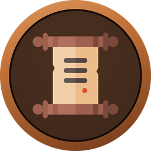

<p align="center"></p>

# TavernDocs bot

A Discord bot that answers questions with links to TavernDocs: guides, game and TavernLib types, settings, console commands, log lines, FAQ, troubleshooting, snippets and TavernMods mods, with live suggestions as you type.

- What it does and its privacy and terms: [the bot's page in the docs](../docs/help/discord-bot.md).
- Adding to it, mostly without code: [CONTRIBUTING.md](CONTRIBUTING.md).

## How it works

The site build writes an index of everything the bot can find to `build/bot/` (see `src/plugins/bot-index` in the site and `src/index/schema.ts` here), and Pages publishes it with the site. The bot downloads it at start, checks for a new one every hour, and searches it in memory.

## Running it

```bash
npm install
cp .env.example .env   # add DISCORD_TOKEN, and DEV_GUILD_ID while testing
npm run dev
```

Or with Docker: `docker build -t taverndocs-bot .` then `docker run --env-file .env -v taverndocs-data:/data taverndocs-bot`.

Commands register in `DEV_GUILD_ID` straight away when it's set, or globally (which can take up to an hour) when it isn't.
