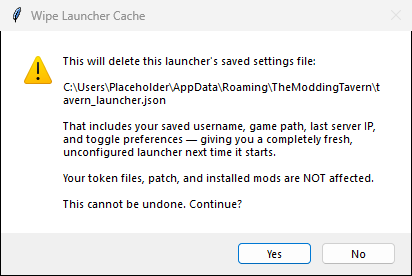

# General troubleshooting

Got a specific problem? Check the troubleshooting page for what you're doing first:

- [Playing](../play/troubleshooting.md)
- [Hosting](../host/troubleshooting.md)
- [Making mods](../mod/troubleshooting.md)

If that doesn't help, try these, in order. Each one is a bigger step than the last.

## 1. Restart everything

Close the game and the launcher, then open the launcher again. If you're on a headset, restart SteamVR or the Meta Quest Link app too. It's boring, but it fixes a lot.

## 2. Run the launcher as Administrator

Right-click the launcher's `.exe` and pick **Run as administrator**. This gets around a surprising number of "it just doesn't work" problems, especially with Setup.

## 3. Repair with Setup

Open **Setup**. Any part that isn't "Up to date" has a button to fix it: **Install**, **Update** or **Repair**. Click it. If one keeps failing, use the **Install manually** button it offers.

## 4. Repair your mods

Open **Mod Manager**. Mods marked **Damaged** don't match their files any more. Reinstall them. **Clear Mod Cache** in **Get Mods** makes the launcher download them fresh.

## 5. Archive the log and try again

**Archive Log** in the launcher starts a fresh game log, so the next try is easy to read. Try again, then look at the log (or send it when [getting help](getting-help.md)).

## 6. Wipe Cache

**Wipe Cache**, bottom right of the launcher, deletes the launcher's saved settings: your game path, username, last server and toggles. It also forgets your added mod sources and pinned mods. Then the launcher closes, so it starts fresh next time.

It **doesn't** touch your tokens, the patch or your installed mods. Read the warning before you click yes.

## 7. Start over with a clean game

If nothing else works:

1. Close the launcher and the game.
2. Move your game folder somewhere else, just in case.
3. Extract a fresh copy from your [backup](../play/getting-started/back-up-your-game.md).
4. Point the launcher at it and run [Setup](../play/getting-started/set-up-the-game.md) again.
5. Reinstall your mods from **Get Mods**.

Your accounts are safe. They live in your tokens, in `%APPDATA%\TheModdingTavern\tokens`, not in the game folder.

## Still stuck?

See [Getting help](getting-help.md).
