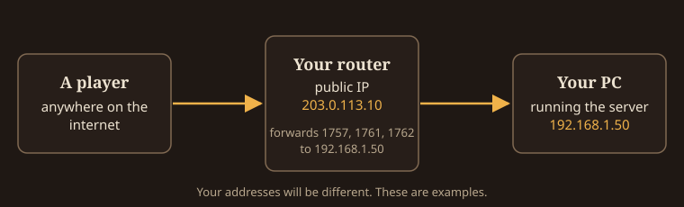

# Ports and port forwarding

:::warning

Read [Before you host](before-you-host.md) first. Opening ports lets anyone on the internet reach the computer behind them.

:::

## The ports

A server uses four ports. These are the defaults:

| Port | Protocol | What it's for | Open it? |
| --- | --- | --- | --- |
| 1757 | UDP | The game itself | **Yes** |
| 1761 | TCP | The web server players load the forest from | **Yes** |
| 1762 | TCP | TavernLib's login. Players' launchers ask it for everything else | **Yes** |
| 1760 | TCP | The server console (Remote Console, TavernKeeper) | **No**, unless you need remote admin |

If the server runs TavernVoice, its voice relay also uses **1759 UDP**. Voice still works without it, but it stutters whenever the server does.

All four can be moved, for example to run two servers on one address. See [Join by name](srv-records.md).

:::note

You might see older guides say to forward the whole range 1757 to 1762. 1758 isn't used any more and 1760 is the console, so forward the three you need instead.

:::

## Do you need to port forward?

- **Playing on your own PC, or with people on the same Wi-Fi?** No. Skip this page.
- **Running on a VPS?** No router, but your provider might have a firewall. See [On a VPS](docker/vps.md).
- **Hosting at home for people elsewhere?** Yes, keep reading.

## How port forwarding works

Your router has one public address that the internet sees. Every device in your home shares it. When a player connects to your public address, the router needs to know which device to send them to. A port forward is a rule that says "send traffic on this port to that PC".



Every router's settings look different, so we can't show you yours. [portforward.com](https://portforward.com/router.htm) has guides for most routers, and a search for your router's model plus "port forwarding" usually finds a video.

## Setting it up

### 1. Find your PC's local IP

On the PC running the server, open PowerShell and run:

```powershell
ipconfig | findstr /i "IPv4"
```

It prints something like `192.168.1.50`. It starts with `192.168.`, `10.` or `172.`. That's your local IP.

Routers can hand out a different local IP after a restart, which breaks your rules. In your router's settings, look for **DHCP reservation**, **static lease** or **fixed IP** and reserve this address for your PC.

### 2. Add the rules on your router

Log in to your router. The address is usually printed on a sticker on the router, often `192.168.1.1` or `192.168.0.1`. Find the port forwarding page (it might be called **Port forwarding**, **Virtual server**, **NAT** or **Applications**) and add three rules, all pointing at your local IP:

| Port | Protocol |
| --- | --- |
| 1757 | UDP |
| 1761 | TCP |
| 1762 | TCP |

Add 1759 UDP too if you run TavernVoice. If you moved any ports, use your numbers instead.

### 3. Allow them in Windows Firewall

Windows usually asks the first time the server starts. Click **Allow**. If you missed it, or want to be sure, run this in PowerShell as Administrator:

```powershell
New-NetFirewallRule -DisplayName "ATT server (game)" -Direction Inbound -Protocol UDP -LocalPort 1757 -Action Allow
New-NetFirewallRule -DisplayName "ATT server (web, login)" -Direction Inbound -Protocol TCP -LocalPort 1761,1762 -Action Allow
```

### 4. Find your public IP

Search "what is my IP" or open [ifconfig.me](https://ifconfig.me). That's the address you give your players (or set up a name for it, see [Join by name](srv-records.md)).

### 5. Test it

Testing your own public IP from inside your home often fails even when everything works, because a lot of routers don't loop traffic back in. Test from outside instead:

- Ask a friend to press **Check Server** in their launcher with your public IP.
- Or turn off Wi-Fi on your phone, share its connection with a laptop, and test from there.

From another network, this checks the login port:

```powershell
Test-NetConnection 203.0.113.10 -Port 1762
```

`TcpTestSucceeded : True` means the login port is reachable. This can't test the game port, since it's UDP. If login works and players still can't load in, check the 1757 UDP rule.

## When port forwarding isn't possible

Some internet providers put many homes behind one public address (this is called **CGNAT**). Port forwarding can't work then. Signs:

- The "WAN" or "Internet" IP on your router's status page is different from the one [ifconfig.me](https://ifconfig.me) shows.
- It starts with `100.64.` to `100.127.`.

You can ask your provider for a public IPv4 address (some do it for free, some charge). Or skip the router completely and [run the server on a VPS](docker/vps.md).

## Something went wrong?

See [Server troubleshooting](troubleshooting.md#nobody-can-connect).
