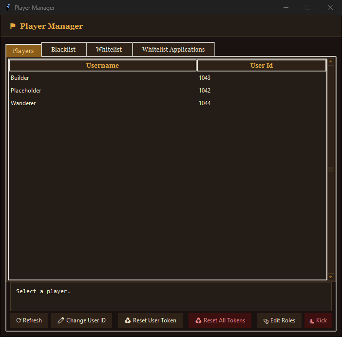

# Players, roles and whitelist

Click **Players** in the Server launcher. The **Player Manager** has four tabs.

## Players

Everyone who has ever joined, with their user ID. Pick a player, then:

| Button | What it does |
| --- | --- |
| **Edit Roles** | Give or take away roles. See [Roles](#roles). |
| **Kick** | Disconnects them. They can join again. |
| **Kick & Ban** | Disconnects them and adds them to the blacklist. |
| **Reset User Token** | Lets someone back into their account if they lost their token file. Only do this if you're sure it's really them. |
| **Change User ID** | Changes their ID. Only for fixing a broken account. |
| **Reset All Tokens** | Resets every player's token. Everyone gets a new one next time they join. |
| **Save Folder** | Opens the folder with the player saves. |

## Roles

Roles are names you add to a player. TavernLib knows these:

| Role | What it gives |
| --- | --- |
| `owner` | Can join in **Fly** mode and change the server's settings from the in-game settings board. |
| `moderator` | Same as `owner`. |
| `fly` | Can join in **Fly** mode, and nothing else. |
| `mod` | Shows as a moderator in the game. |
| `dev` | Shows as a developer in the game. |
| `supporter` | Shows as a supporter in the game. |

To add one: pick the player, click **Edit Roles**, type the role, click **+ Add**, then **Save Roles**.

**Fly** is a flatscreen mode for flying around the world, picked as the platform in the client launcher. Anyone without `owner`, `moderator` or `fly` who tries it is kicked with "Bizarre mode detected." Give yourself `owner` if you're the host.

Some mods use their own roles. Their page will say if you need to add one.

## Blacklist

Players and addresses that can't join. Pick **Username** or **IP** on the bottom left, type it in, and click **+ Add**.

## Whitelist

When **Enable whitelist** is on in [Settings](settings.md), only players on this list can join. Add a username or an IP the same way as the blacklist. **Edit Comment** lets you note who an entry is.

An IP on the whitelist lets in everyone on that connection. Only add one for a place where you trust everyone. A VPN or a shared connection can put strangers behind the same IP.

## Whitelist Applications

When the whitelist is on, players who aren't on it can ask to join. Their requests show up here. **Approve** adds their username to the whitelist, with the IP they asked from as its comment. **Deny** removes the request.

One address can have at most 3 requests waiting, and the list holds at most 100.

## Something went wrong?

See [Server troubleshooting](../troubleshooting.md).
