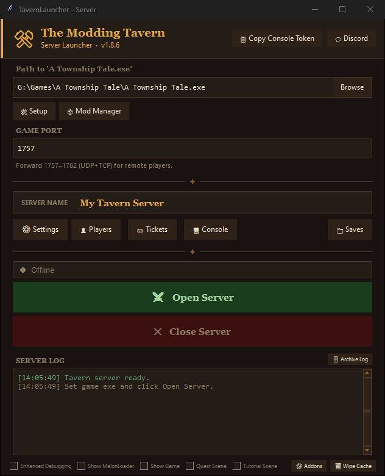

# Windows: set up and start

The Server launcher runs a server on your Windows PC. It looks and works a lot like the client launcher you play with.

## 1. Get the Server launcher

1. Go to the [TavernLauncher releases page](https://github.com/ModdingTavern/TavernLauncher/releases/latest).
2. Under **Assets**, download `TavernLauncher-Server-vX.Y.Z.zip` (the numbers will be the latest version).
3. Right-click the zip, **Extract All...**, and put it somewhere you'll find again, like `Documents\TavernLauncher Server`. Not your Downloads folder.
4. Open the folder and double-click `TavernLauncher - Server.exe`.

If Windows SmartScreen or your antivirus complains, see [Install the launcher](../../play/getting-started/install-the-launcher.md). It's the same for both launchers.

## 2. Point it at a game copy

Click **Browse** and pick `A Township Tale.exe`.

You can use the same game folder you play from. The client and server share its mods, which is fine. If you want them kept apart, make a second copy of your [game backup](../../play/getting-started/back-up-your-game.md) just for the server.

## 3. Run Setup

The **Setup** button flashes until everything's installed. Click it, then **Automatic Setup**. It's the same Setup as the client: Patch, then MelonLoader, then TavernLib. See [Set up the game](../../play/getting-started/set-up-the-game.md) for what each one does and what to do if one fails.

If you already ran Setup on this game folder with the client launcher, there's nothing to do.

## 4. Name it

Type a name in **SERVER NAME**. This is what players see.

Leave **GAME PORT** at `1757` unless you're running more than one server. See [Join by name](../srv-records.md#two-servers-on-one-address).

For a password, player limit and the rest, see [Settings](settings.md).

## 5. Open the server

Click **Open Server**. The server starts in the background and its log shows in **SERVER LOG**.

If Windows Firewall asks about the server, click **Allow**. Otherwise your firewall might block players, and you.

:::warning[Wait before joining a new world]

A new world spends its first few minutes generating the forest. Anyone who joins before that finishes gets a broken forest. Give it a few minutes.

:::

## 6. Join it

On the same PC, open the client launcher, leave **Destination** empty (that means this PC) and click **Join Server**. Friends on the same Wi-Fi use your PC's local IP.

For friends anywhere else, you need to [port forward](../ports.md) first.

## Closing it

Click **Close Server**. It saves the world first, which can take a little while on a new world. Let it finish.

Mod changes only take effect when the server starts, so close it before installing or updating mods. See [Mods on your server](../mods-on-your-server.md).

## The options at the bottom

| Option | What it does |
| --- | --- |
| **Show MelonLoader** | Opens MelonLoader's log window with the server. Leave it on. |
| **Show Game** | Shows the server as a normal game window. Leave it off. |
| **Quest Scene** | Runs the Quest version of the world: no forest, lighter graphics. |
| **Tutorial Scene** | Runs the tutorial world. |
| **Enhanced Debugging** | Extra logging, for when you're asked for it. |

Scene changes apply the next time you open the server.

## Something went wrong?

See [Server troubleshooting](../troubleshooting.md#windows-server-launcher).
