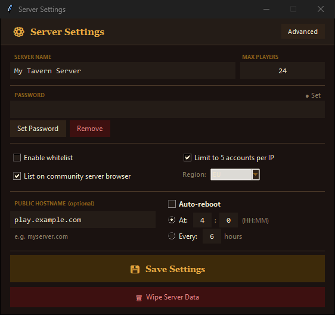

# Settings

Click **Settings** in the Server launcher. Change what you want, then click **Save Settings**.

| Setting | What it does |
| --- | --- |
| **SERVER NAME** | The name players see. |
| **MAX PLAYERS** | How many players can be on at once. 24 by default, up to 999. |
| **PASSWORD** | Type one and click **Set Password**. Players have to enter it to join. **Remove** takes it off again. |
| **Enable whitelist** | Only players on your whitelist can join. Others can ask to join. See [Players, roles and whitelist](players.md). |
| **Limit to 5 accounts per IP** | Stops one person making loads of accounts. Leave it on. |
| **List on community server browser** | Puts your server on Community Servers. See [Getting listed](../getting-listed.md). |
| **Region** | Where your server is. Shown on the list so players can find one near them. |
| **PUBLIC HOSTNAME** | A name like `play.example.com` to show on the list instead of your IP. It has to point at your PC's public IP. |
| **Auto-reboot** | Restarts the server on a timer. Servers that run for days get slower, so this is worth turning on. Pick a time (**At**) and how often (**Every** so many hours). |

:::warning

Listing your server shows your IP address to everyone. If you host from home and would rather not, leave it off.

:::

Name and password changes work straight away. Listing changes need the server to be closed and opened again.

## Advanced

**Advanced** has three more:

| Setting | What it does |
| --- | --- |
| **GarbageCollectionTime** | Seconds between the game's memory clean-ups. It doesn't touch items in the world. Default 30. Needs a restart. With Steady installed, the clean-ups only run if this isn't 30. |
| **ServerBackupTime** | Hours between automatic world backups. 0 is off. |
| **ServerBackupMaxBackups** | How many backups to keep. 0 keeps them all. |

See [Saves and backups](saves-and-backups.md).

## Wipe Server Data

**Wipe Server Data** deletes every server world on this PC, with all its saves and settings. It can't be undone. Back up first if there's any chance you'll want it.

## Something went wrong?

See [Server troubleshooting](../troubleshooting.md#windows-server-launcher).
