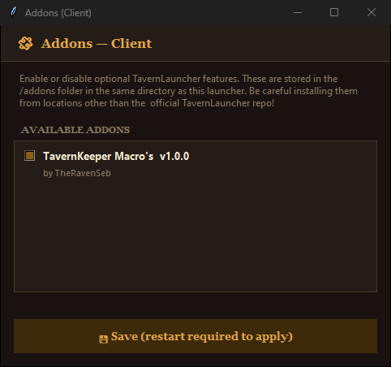

# How addons work

An addon adds features to TavernLauncher: a button, a TavernKeeper tab, something that runs before the game starts. Addons are plain Python, loaded by the launcher when it starts. You don't need to build the launcher to make one.

## Where they live

Addons go in the `addons` folder next to the launcher's `.exe`, one folder each:

```
TavernLauncher - Client.exe
addons/
  macros/
    __init__.py
    author.json
    client.py
  hello/
    __init__.py
    author.json
    client.py
    server.py
```

| File | What it's for |
| --- | --- |
| `author.json` | Your addon's name, author and version, and any mods it needs. Required. See [Sharing an addon](sharing-an-addon.md#authorjson). |
| `client.py` | Loaded by the **Client** launcher. |
| `server.py` | Loaded by the **Server** launcher. |
| `__init__.py` | Can be empty. Makes the folder a Python package so your files can import each other. |

An addon can have either or both of `client.py` and `server.py`. A folder whose name starts with `_` is skipped.

## Turning one on

Addons are off until a player turns them on. In either launcher:

1. Click **Addons** at the bottom.
2. Tick the addon.
3. Click **Save (restart required to apply)** and restart the launcher.



The Client and Server launchers keep separate lists, so you can turn an addon on in one and not the other. They're saved in `client_enabled_addons.json` and `server_enabled_addons.json` in `%APPDATA%\TheModdingTavern`.

When the launcher starts, it imports `addons.<name>.client` (or `.server`) for each one that's on. Your file runs once, at import, before the main window is built. That's when you register your buttons, tabs and hooks.

## When it goes wrong

If your file raises while loading, the launcher still starts. The **Addons** window shows your addon as failed, with **Show error** for the traceback, and it's written to `addon_load_errors.log` in `%APPDATA%\TheModdingTavern`. A button or hook that raises later is reported in the launcher's log, and the rest of the launcher carries on.

## What you can use

Addons run inside the launcher, so they can import anything it has. The parts meant for addons are listed in the [Hooks reference](hooks-reference.md). Anything else is the launcher's own code and can change between versions.

:::warning

Addons run with the same access as the launcher. That includes your tokens and your game folder. Players should only turn on addons from people they trust, and you should never ask for more than your addon needs.

:::
