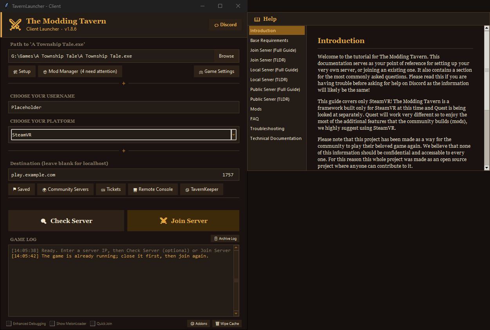

import Tabs from '@theme/Tabs';
import TabItem from '@theme/TabItem';

# Install the launcher

<Tabs groupId="client" queryString>
<TabItem value="pc" label="PC" default>

**TavernLauncher** sets up your game and gets you onto servers. There's no installer. You download a zip, unzip it, and run it.

## 1. Download it

1. Go to the [TavernLauncher releases page](https://github.com/ModdingTavern/TavernLauncher/releases/latest).
2. Scroll down to **Assets**.
3. Click **TavernLauncher-Client-vX.Y.Z.zip** to download it. The numbers will be the newest version.

There's a **Server** zip too. You don't need that one to play.

:::warning

Only download the launcher from that page. A copy from anywhere else could be anything.

:::

## 2. Unzip it

1. Find the zip in your **Downloads** folder.
2. Right-click it and pick **Extract All...**.
3. Pick somewhere you'll find again, like `Documents\TavernLauncher`. Not your Downloads folder, since you'll be back here when there's an update.
4. Click **Extract**.

Inside you'll find:

- **TavernLauncher - Client.exe**, the launcher.
- **Patch**, a folder of backup copies the launcher uses if a download fails. Leave it next to the launcher.
- **addons**, a folder for extras. You can ignore it.

## 3. Open it

Double-click **TavernLauncher - Client.exe**.

**If Windows says "Windows protected your PC":** that's SmartScreen. It warns about any program that isn't well known yet. Click **More info**, then **Run anyway**.

**If your antivirus complains:** the launcher changes game files, which some antivirus programs don't like. It's [open source](https://github.com/ModdingTavern/TavernLauncher), so anyone can check what it does. You might need to allow it in your antivirus.

**If Windows Firewall asks about it:** click **Allow**. The launcher needs the internet to talk to servers.

The launcher opens. On the right edge there's a small **📖** tab. Click it any time for the built-in help.

</TabItem>
<TabItem value="quest" label="Quest">

:::note[Coming soon]

How to install the standalone Quest version on your headset.

:::

</TabItem>
</Tabs>

## Next

[Set up the game](set-up-the-game.md).

## Something went wrong?

See [Troubleshooting](../troubleshooting.md#the-launcher-wont-open).
