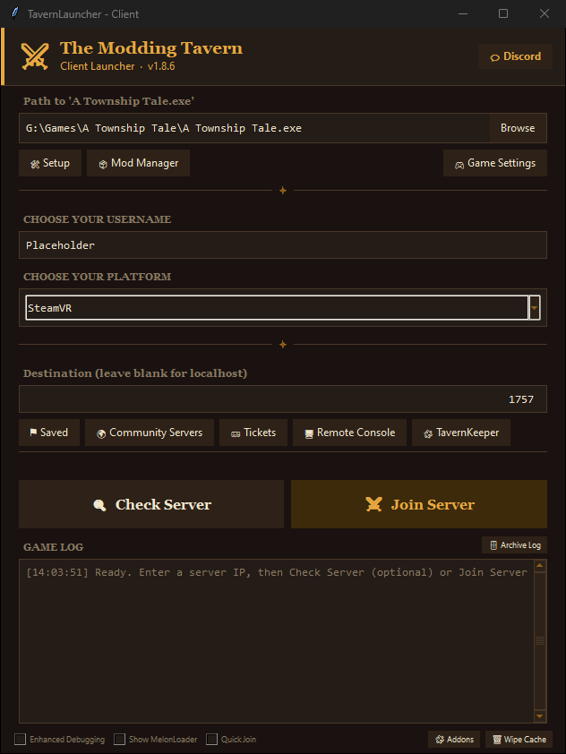
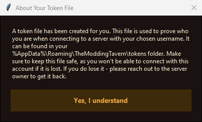
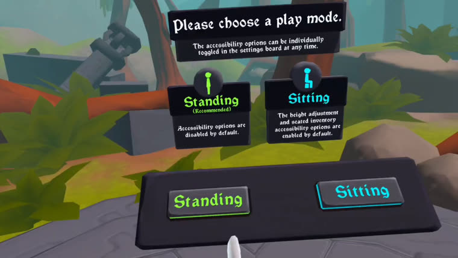
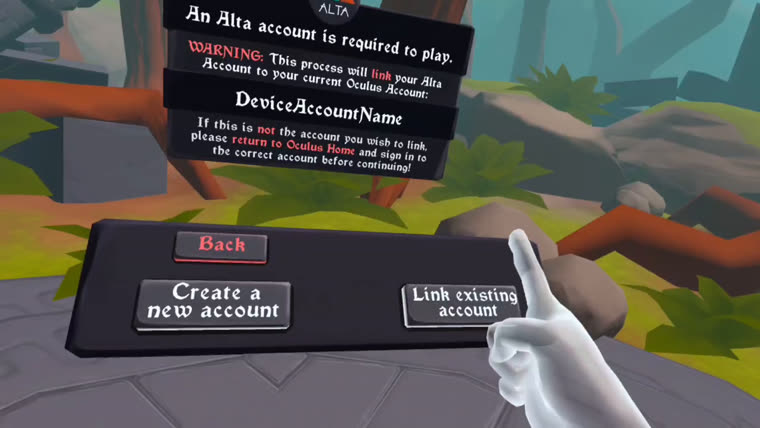
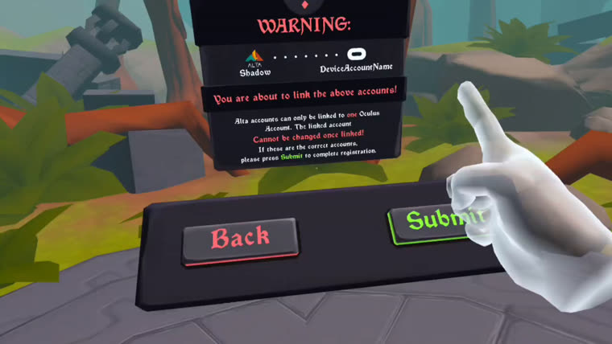

import Tabs from '@theme/Tabs';
import TabItem from '@theme/TabItem';

# Pick your name and headset

<Tabs groupId="client" queryString>
<TabItem value="pc" label="PC" default>

## Your username

Type a name under **CHOOSE YOUR USERNAME**. It's what other players see.

- Up to 16 characters.
- Letters, numbers, spaces, `-` and `_`.

Every server keeps its own list of players. Your name is saved on each server the first time you join it. Someone else might already have your name on a server, so pick something unusual.

## Your headset

Under **CHOOSE YOUR PLATFORM**, pick what you play on:

| Pick | If you play on |
| --- | --- |
| **SteamVR** | A headset that works with SteamVR: Index, Vive, Windows Mixed Reality and others. |
| **Quest** | A Meta Quest or Rift connected to your PC with the Meta Quest Link app. |
| **Fly** | Flying around without a headset. Only for server staff, see below. |

Start SteamVR or the Meta Quest Link app before you join a server.

**Fly** is a flatscreen mode for moving around a world. A server only lets you in with it if its owner gave you the role for it. Otherwise you get kicked with "Bizarre mode detected."

## Your token: the key to your account

There's no password. Instead, the first time you join a server, the launcher makes a **token file** for you and shows **About Your Token File**:

> A token file has been created for you. This file is used to prove who you are when connecting to a server with your chosen username. It can be found in your %AppData%\Roaming\TheModdingTavern\tokens folder. Make sure to keep this file safe, as you won't be able to connect with this account if it is lost. If you do lose it - please reach out to the server owner to get it back.

Click **Yes, I understand**.

Think of the token like a house key:

- **Don't lose it.** Without it, you can't get into your account on that server. Only the server's owner can reset it.
- **Don't share it.** Anyone with your token can play as you.
- **Back it up.** Copy the `%APPDATA%\TheModdingTavern\tokens` folder somewhere safe now and then. Paste that path into File Explorer's address bar to find it.

If you move to a new PC, copy the `tokens` folder across and your accounts come with you.

</TabItem>
<TabItem value="quest" label="Quest">

The first time you start the Quest build, it asks two things: how you want to play, and the name you'll play under.

## How you play

Pick **Standing** or **Sitting**. You can change the accessibility options later on the Settings panel, so either is fine to start with.

## Your name

On the account screen, press **Link existing account**. (**Create a new account** does the same thing, with a few more steps.)

Type the name you want and a password, then press **Submit**.

- 3 to 20 characters.
- Letters, numbers, `_` and `-`.

Every server keeps its own list of players, so someone else might already have your name on a server. Pick something unusual.

A red warning says the accounts "cannot be changed once linked." That text is left over from the old game. You can log out and use a different name later, from the **Quest login** page on the Mods board.

:::note[Your name and password are your login]

Unlike the PC launcher, the Quest build has no token file. Your name and the password you set are how you log back in, so keep the password somewhere safe. If you forget it, a server's owner can reset your account on their server.

:::

</TabItem>
</Tabs>

## Next

[Join a server](../joining/community-servers.md).
