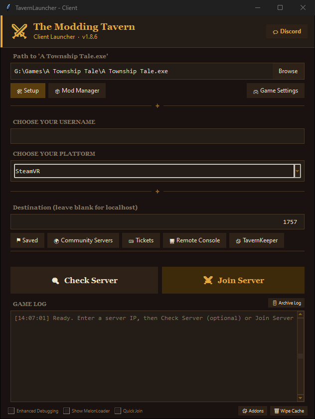
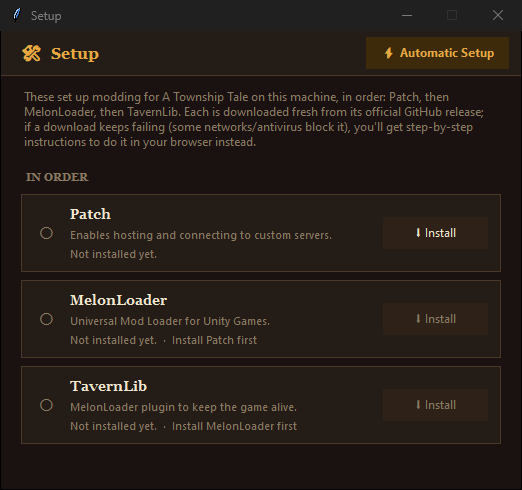
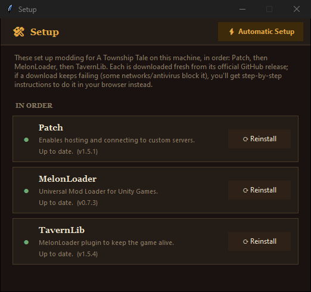
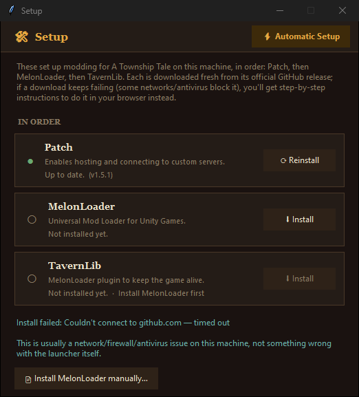
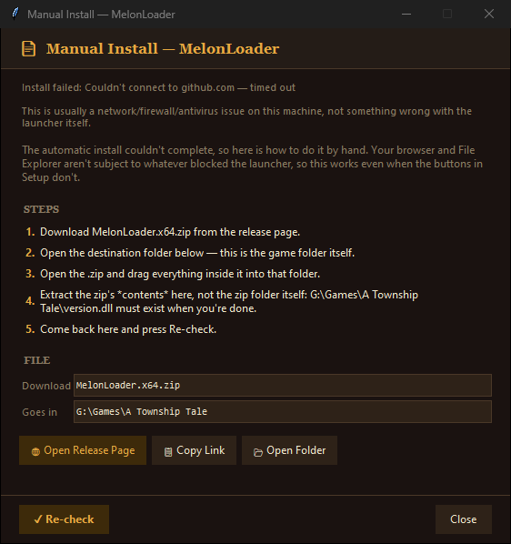
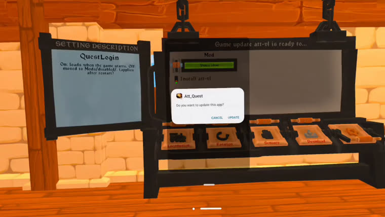

import Tabs from '@theme/Tabs';
import TabItem from '@theme/TabItem';

# Set up the game

<Tabs groupId="client" queryString>
<TabItem value="pc" label="PC" default>

Your game needs three things added before it can join community servers. The launcher's **Setup** does all of it.

## 1. Show the launcher your game

At the top of the launcher there's a box called **Path to 'A Township Tale.exe'**.

1. Click **Browse**.
2. Go to your game folder (usually `C:\Games\Alta\A Township Tale`).
3. Pick **A Township Tale.exe** and click **Open**.

Until you do this, **Setup** and **Mod Manager** are greyed out.

## 2. Run Setup

Once the path is set, the **Setup** button flashes. That means something needs installing.

1. Click **Setup**.
2. Click **Automatic Setup**.
3. Wait while it installs each part, from top to bottom.

It installs three things:

| | What it does |
| --- | --- |
| **Patch** | Lets your game join community servers instead of Alta's old ones. |
| **MelonLoader** | Loads mods into the game. Everything else needs it. |
| **TavernLib** | Keeps the game working without Alta: logging in, mods, and more. |

When all three say **Up to date**, you're done. Close the Setup window. The **Setup** button stops flashing.

## If a part won't install

Some antivirus programs and networks block the downloads. If that happens:

1. Try once more with **Install** on that row.
2. Still failing? Click **Install ... manually...** on that row. It opens step by step instructions: download the file in your browser, then put it where it shows you.
3. Click **Re-check** when you've done it.

See also [Setup won't finish](../troubleshooting.md#setup-wont-finish).

## Later on

When there's an update to any of the three, the **Setup** button flashes again. Open it and click **Update**. If a part says it doesn't match what was installed, click **Repair**.

</TabItem>
<TabItem value="quest" label="Quest">

There's nothing to set up. The Quest build already has everything in it: the game, the parts that let it join community servers, and the mods you need. Once you've [installed it](install-the-launcher.md?client=quest) and picked your name, you're ready to play.

## Keeping it up to date

You never download the game by hand again. Mods update themselves, and game updates take one lever pull.

**When a game update is ready**, a *Game update att-v1* notice appears in town after a minute or so. To install it:

1. On the Settings panel, pull the **Mods** lever (the one with the gear).
2. Go to **Installed mods** and pull **Install att-v1**.
3. When the headset asks *"Do you want to update this app?"*, press **Update**. The game closes; start it again (and press **Open App**).

Your name and settings stay. The Mods board then says **Up to date**.

**Mod updates** install on the next start: start the game, wait a minute in town, close it, and start it again.

</TabItem>
</Tabs>

## Next

[Pick your name and headset](name-and-headset.md).
