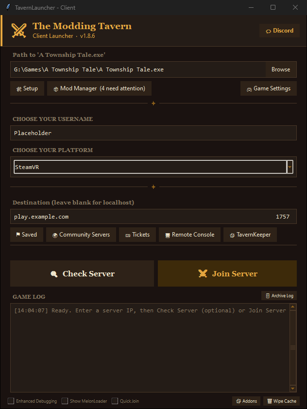
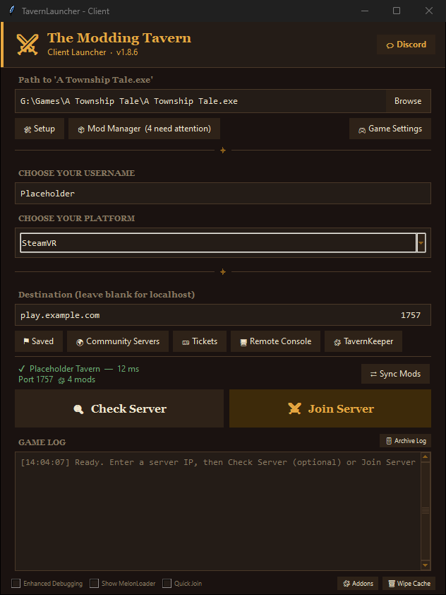
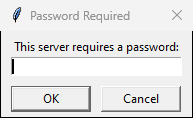
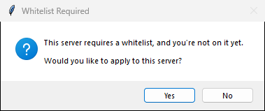

import Tabs from '@theme/Tabs';
import TabItem from '@theme/TabItem';

# Join by address or name

If a friend runs a server, they give you its address. That's either:

- **an IP address**, like `203.0.113.10`, or
- **a name**, like `play.example.com`.

<Tabs groupId="client" queryString>
<TabItem value="pc" label="PC" default>

## Joining

1. Type the address in **Destination**.
2. Click **Check Server** (you can skip this, but it's handy).
3. Click **Join Server**.

**Check Server** asks the server if it's there without joining. If it is, the log shows ✔ with its name and ping, and whether it needs a password, has a whitelist, or runs mods.

Leave **Destination** empty to join a server running on your own PC.

### About the port box

The small box next to **Destination** is the port. You almost never need to touch it. The launcher asks the server which port to use when you join.

If someone gives you an address with a port on the end, like `203.0.113.10:1757`, paste it all into **Destination**. The launcher moves the port into the box for you.

## Password

If the server has a password, the launcher asks for it when you join. Type it and click OK.

## Whitelist

Some servers only let in players on their whitelist. If you're not on it, the launcher offers to send the owner a request. Once they approve it, join again.

</TabItem>
<TabItem value="quest" label="Quest">

The Quest build joins servers from the in-game board rather than by typing an address. See [Community Servers](community-servers.md?client=quest).

To reach a particular server, find it on the board with the **keypad filter** (type part of its name). If it isn't listed, ask whoever runs it to [get it listed](../../host/getting-listed.md); that's what puts it on the board.

</TabItem>
</Tabs>

## What happens next

The launcher logs you in, checks your mods match the server's (see [Servers with mods](servers-with-mods.md)), and starts the game. You go straight into the server.

The first time you join any server, you'll see **About Your Token File**. Read it, it matters. See [Your token](../getting-started/name-and-headset.md#your-token-the-key-to-your-account).

Every server you join is saved in [Recent](saved-and-recent.md).

## Something went wrong?

- **"Cannot reach server".** The address is wrong, the server is off, or it can't be reached from where you are. Check the address with whoever runs it.
- **"That name is taken by someone else."** Someone already has your name on that server. Pick another, or if it's yours and you lost your token, ask the server's owner.
- **"Wrong password."** Check it with whoever gave it to you. It's case sensitive.
- **You end up in the game's main menu instead of the server.** Setup didn't fully work. See [Sent to the main menu](../troubleshooting.md#sent-to-the-main-menu-or-a-black-screen).

More in [Troubleshooting](../troubleshooting.md#joining).
