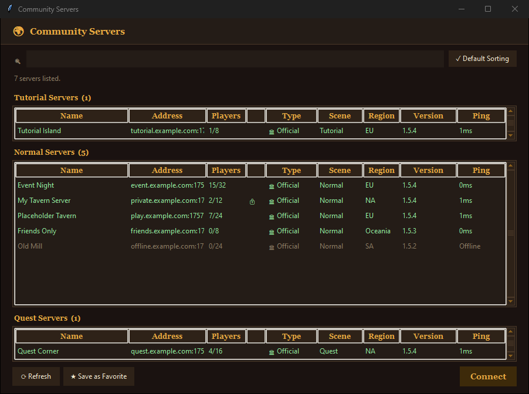

import Tabs from '@theme/Tabs';
import TabItem from '@theme/TabItem';

# Community Servers

The easiest way to find a server. Hosts can put their server on this list, and you can join any of them in a couple of clicks.

<Tabs groupId="client" queryString>
<TabItem value="pc" label="PC" default>

## Joining one

1. Click **Community Servers**.
2. Pick a server from the list.
3. Click **Connect**. The window closes and the server's address is filled in for you.
4. Click **Join Server**.

The game starts and puts you in the server. The first time, it might take a minute.

## Reading the list

The list is split into **Normal Servers**, **Tutorial Servers** and **Quest Servers**. Quest servers run a lighter world with no forest.

| Column | What it tells you |
| --- | --- |
| **Players** | How many people are on, and how many fit. |
| 🔒 | It needs a password. |
| **Type** | **Official** servers are run with the Server launcher. **Headless** ones run on a server machine. They play the same. |
| **Region** | Where in the world it is. Closer is smoother. |
| **Ping** | How long it takes to reach. Lower is better. **Offline** means you can't reach it right now. |

Click a column's title to sort by it. **Default Sorting** puts it back. **Refresh** gets the list again.

Like one? Pick it and click **Save as Favorite** to find it again in [Saved](saved-and-recent.md).

</TabItem>
<TabItem value="quest" label="Quest">

:::note[Coming soon]

Finding servers in the standalone Quest version.

:::

</TabItem>
</Tabs>

## The server boards in the game

With the **TavernEssentials** mod, the game's main menu has server boards too. Install it from [Get Mods](../mods/getting-mods.md). A **Main Menu** button then appears next to **Join Server**, which starts the game at the main menu instead of joining a server.

## Something went wrong?

- **The list is empty or says "Could not reach community list".** The list service might be down, or your internet or firewall is blocking it. You can still join servers [by their address](address-or-name.md).
- More in [Troubleshooting](../troubleshooting.md#joining).
