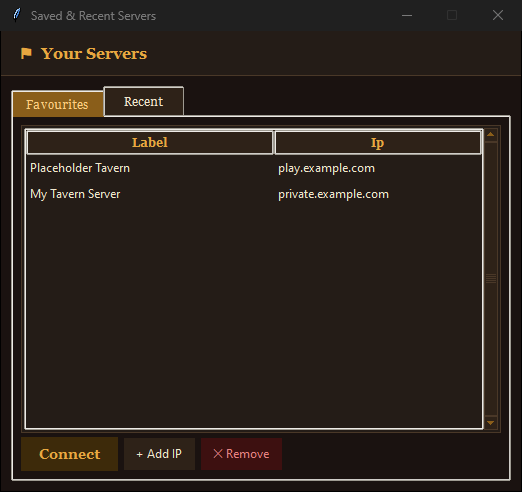

# Saved and recent servers

Click **Saved**. The **Saved & Recent Servers** window has two tabs:

- **Favourites**: servers you saved.
- **Recent**: servers you joined lately.

Pick one and click **Connect** to fill in its address, then **Join Server**.

| Button | What it does |
| --- | --- |
| **Connect** | Fills in the server's address. |
| **+ Add IP** | Saves a server by typing its address. |
| **Save as Fav** | On **Recent**, moves a server into **Favourites**. |
| **Remove** | Takes a server off the list. |

You can also save a server straight from [Community Servers](community-servers.md) with **Save as Favorite**.
