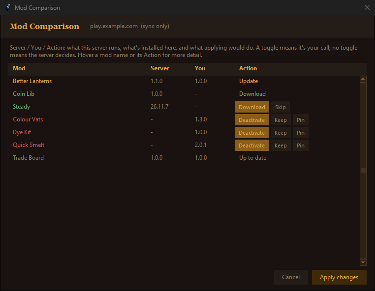
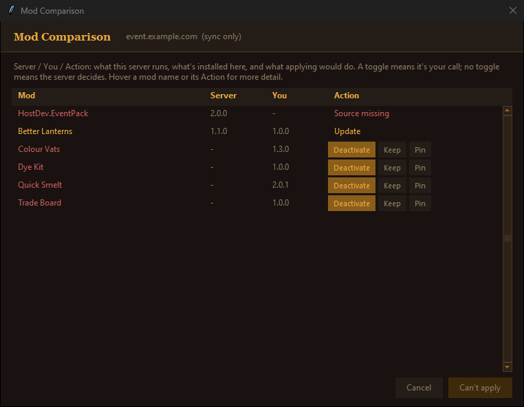
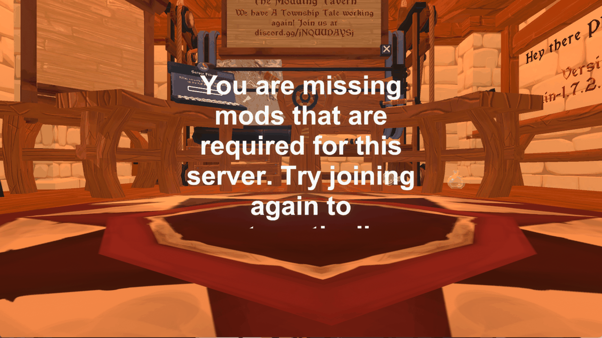
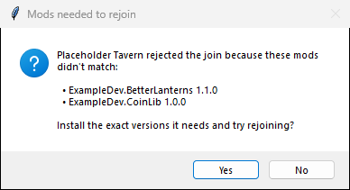

# Servers with mods

Lots of servers run mods. Some of them you need too, so the launcher checks your mods against the server's **before** the game starts, and sorts out the difference.

## The Mod Comparison window

If your mods don't match the server's, the **Mod Comparison** window opens when you click **Join Server**. Each row is a mod, with the server's version, yours, and what the launcher will do:

| Action | Means |
| --- | --- |
| **Download**, **Install** | You don't have it. The launcher gets it. |
| **Update**, **Downgrade** | You have a different version. The launcher switches you to the server's. |
| **Deactivate** | You have a mod the server doesn't run. It's turned off for this server. Not deleted. |
| **Up to date** | Nothing to do. |

Some mods give you a choice:

- Mods marked **Exact version required** have to match. No choice there.
- The server's other mods are recommended. Pick **Skip** to leave one out.
- For your own mods that the server doesn't run, pick **Keep** to leave one on for this join, or **Pin** to keep it on everywhere.

Click **Apply changes**. When it's done, the game starts.

Click **Cancel** to not join. Nothing changes.

### "Can't apply"

Sometimes the launcher can't get a mod the server needs:

- **The mod isn't in any source you've added.** The server got it from a source you don't have. The window says which. Add it in [Mod sources](../mods/mod-sources.md) if you trust it.
- **A version has been withdrawn.** The server is running a version that was pulled because it was broken or harmful. Nobody can join until the host updates it. Let them know.

## Checking without joining

**Check Server** shows how many mods a server runs, with a **Sync Mods** button. That opens the same window without joining, so you can get ready before you play.

## If the game turns you away

Sometimes you get into the game and it says:

> You are missing mods that are required for this server. Try joining again to automatically install missing mods.

That happens if you joined from inside the game (like from a server board), or the server changed its mods while you were away. To fix it, **try joining the same server again from the game**, within 10 minutes. The game closes, the launcher installs what's needed, and you go straight back in.

If you close the game instead and open the launcher yourself, it asks **Mods needed to rejoin**. Click **Yes** to install them and rejoin.

## Quick Join

Tick **Quick Join**, at the bottom of the launcher, to skip the questions:

- The launcher matches your mods to the server's without showing the Mod Comparison window.
- If the game turns you away for mods, it closes by itself, installs them and rejoins.

You'll still be asked if one of your pinned mods doesn't work with the server's.

## Your mods aren't lost

Mods turned off for one server stay installed. They come back on when you join a server that runs them, or you turn them on in the [Mod Manager](../mods/managing-mods.md).

## Something went wrong?

See [Troubleshooting](../troubleshooting.md#mods).
