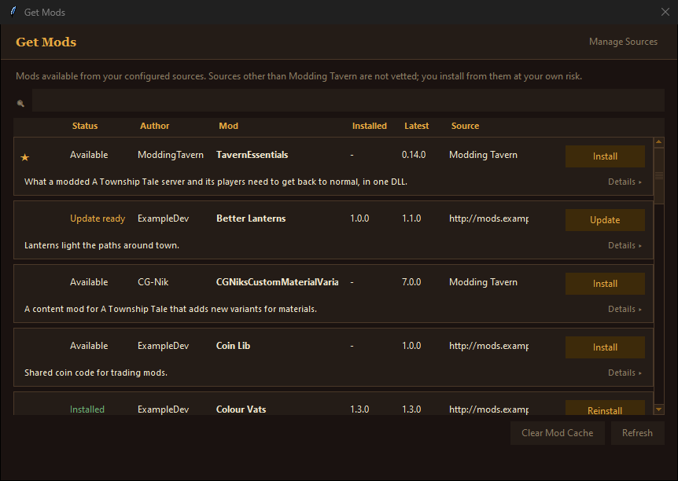
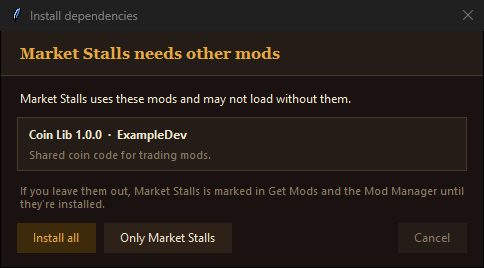

# Getting mods

You don't have to install mods yourself to play on modded servers. The launcher does that when you join. But you can add mods you like for your own game too.

## Get Mods

1. Close the game. Mods can't change while it's running.
2. Click **Mod Manager**, then **Get Mods**.
3. Search or scroll for a mod. Each one shows its author, what it does, and the newest version.
4. Click **Details** to see more about it.
5. Pick it and click **Install**. For a mod you already have, the same button says **Update** when there's a newer version.

The next time you start the game, it's loaded.

## Mods that need other mods

Some mods need other mods to work. When you install one, the launcher tells you:

- **Install all** installs it and everything it needs. Pick this one.
- **Only ...** installs just the mod you picked. It won't work until you add the rest, and shows **Needs mods**.
- **Cancel** installs nothing.

A mod that says **Needs mods** can be fixed later with **Install Dependencies** in the **Mod Manager**.

## Mods that don't work together

Some mods clash with each other. If you install or turn on one of a pair, the launcher warns you and offers to turn the other one off.

## Exact version or any version

The details say one of two things:

- **Exact version required**: on a server, everyone needs the server's exact version. The launcher handles it when you join.
- **Any compatible version**: any version works.

## Where they come from

Mods come from **TavernMods**, The Modding Tavern's mod list. Every mod there is checked and scanned before it's listed. You can browse it on the web too: [moddingtavern.github.io/TavernMods](https://moddingtavern.github.io/TavernMods/).

You can add other lists in [Mod sources](mod-sources.md), but nobody checks those for you.

## Something went wrong?

- **A download keeps failing.** Click **Clear Mod Cache**, then try again. Check your antivirus isn't blocking it.
- More in [Troubleshooting](../troubleshooting.md#mods).
