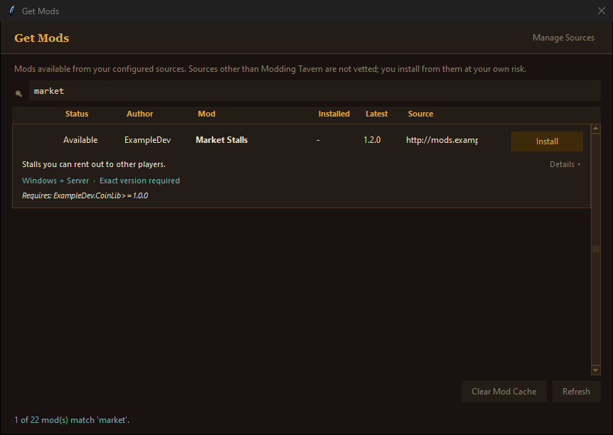

import Tabs from '@theme/Tabs';
import TabItem from '@theme/TabItem';

# Getting mods

<Tabs groupId="client" queryString>
<TabItem value="pc" label="PC" default>

You don't have to install mods yourself to play on modded servers. The launcher does that when you join. But you can add mods you like for your own game too.

## Get Mods

1. Close the game. Mods can't change while it's running.
2. Click **Mod Manager**, then **Get Mods**.
3. Search or scroll for a mod. Each one shows its author, what it does, and the newest version.
4. Click **Details** to see more about it.
5. Pick it and click **Install**. For a mod you already have, the same button says **Update** when there's a newer version.


The next time you start the game, it's loaded.

## Mods that need other mods

Some mods need other mods to work. When you install one, the launcher tells you:

- **Install all** installs it and everything it needs. Pick this one.
- **Only ...** installs just the mod you picked. It won't work until you add the rest, and shows **Needs mods**.
- **Cancel** installs nothing.


A mod that says **Needs mods** can be fixed later with **Install Dependencies** in the **Mod Manager**.

## Mods that don't work together

Some mods clash with each other. If you install or turn on one of a pair, the launcher warns you and offers to turn the other one off.

## Exact version or any version

The details say one of two things:

- **Exact version required**: on a server, everyone needs the server's exact version. The launcher handles it when you join.
- **Any compatible version**: any version works.



## Where they come from

Mods come from **TavernMods**, The Modding Tavern's mod list. Every mod there is checked and scanned before it's listed. You can browse it on the web too: [moddingtavern.github.io/TavernMods](https://moddingtavern.github.io/TavernMods/).

You can add other lists in [Mod sources](mod-sources.md), but nobody checks those for you.

## Something went wrong?

- **A download keeps failing.** Click **Clear Mod Cache**, then try again. Check your antivirus isn't blocking it.
- More in [Troubleshooting](../troubleshooting.md#mods).

</TabItem>
<TabItem value="quest" label="Quest">

On Quest, mods are built into the game. There's no launcher and you don't need a PC. The mods a community server needs come down with the game, and when you want to add more, you get them from a board in town.

Most people never add a mod by hand. The board is the normal way, and it's there whenever you want it.

## The Download board

The mods boards are on the **Settings** panel in town.

1. Open the **Settings** panel and pull the **Mods** lever, the one with the gear.
2. Go to the **Download** board. It lists the mods you can add, each with what it does and who made it.
3. Pull a mod's lever to choose it. It changes to **Chosen, not downloaded yet**. Turn the **Page** drum for more mods.
4. When you've picked what you want, pull **Save and close**. The game closes.
5. Start the game again and press **Open App**. Your mods download while you wait in town, then load. Back on the **Download** board they now say **Downloaded**.

Every mod on the board comes from The Modding Tavern's Quest mod list and is checked before the game installs it, so there's nothing to vet yourself. If the board says **No mods to download yet** or **Could not check for mods**, your build may be too old for the current list; install the game update first (see [Set up the game](../getting-started/set-up-the-game.md?client=quest)).

To turn a mod off later, go to the **Installed mods** board on the same lever and pull its toggle. **On** loads it when the game starts; **Off** sets it aside without deleting it.

## Adding a mod by hand

The Quest build runs on MelonLoader, the same mod loader as the PC game, so you can drop a mod in yourself if it isn't on the board. You need to reach the game's folder on the headset, which means plugging the headset into a PC, or using a file manager that can open **Android/data**.

1. Close the game.
2. On the headset's storage, open this folder:

   ```
   Android/data/com.Alta.ATownshipTale/files/Mods
   ```

3. Copy the mod's `.dll` straight into that **Mods** folder (not a subfolder).
4. Start the game. The mod loads, and it appears on the **Installed mods** board as a toggle you can turn on and off like any other.

A few things to know:

- **It has to be a Quest mod.** A mod built for the PC game won't load on the headset; it needs a build made for Quest. If in doubt, stick to the board.
- **The game leaves it alone.** Mods you add by hand are never removed, overwritten or updated for you, so keeping them current is on you.
- **Turning one off** moves its file into a `disabled` folder beside it, rather than deleting it. Turn it back on and it moves back.

## One list only

Unlike the PC launcher, the Quest build has a single mod list: The Modding Tavern's. There's no way to point it at someone else's. Anything that isn't on the board has to go in by hand, as above.

## Something went wrong?

- **A mod you added by hand doesn't show up.** Check it's a Quest build and that the `.dll` sits directly in **Mods**, not a subfolder. Start the game, wait in town a moment, then open the **Installed mods** board.
- **New mods don't appear on the board.** Your build may be too old for the current list. Install the game update, then check again. See [Set up the game](../getting-started/set-up-the-game.md?client=quest).
- More in [Troubleshooting](../troubleshooting.md?client=quest).

</TabItem>
</Tabs>
