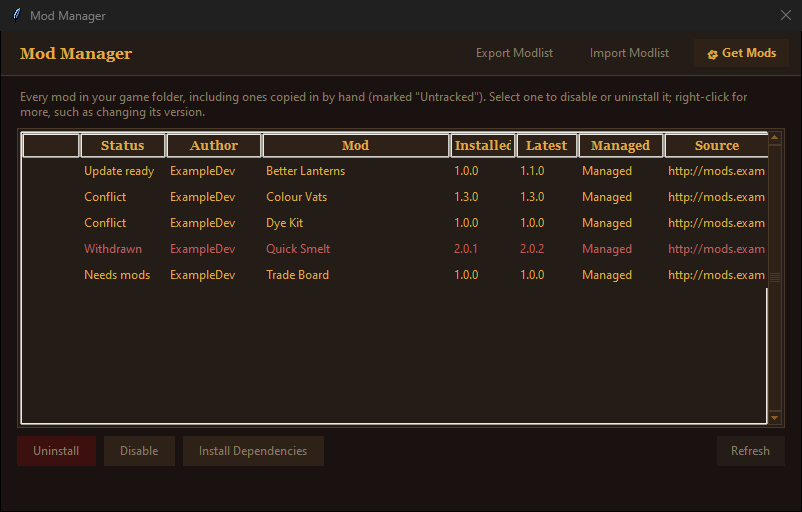
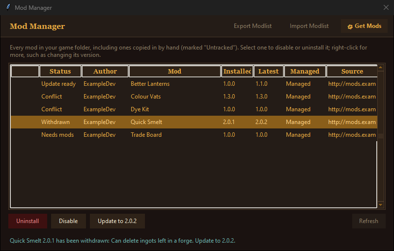
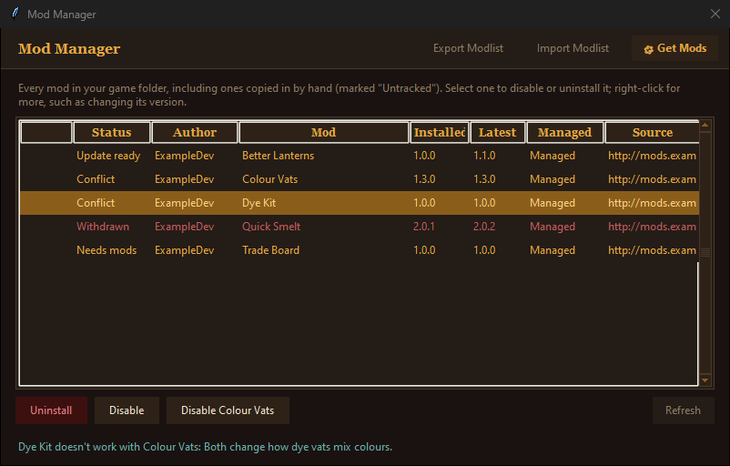
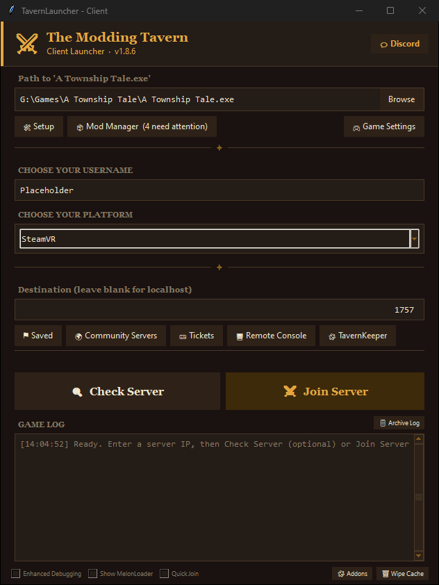
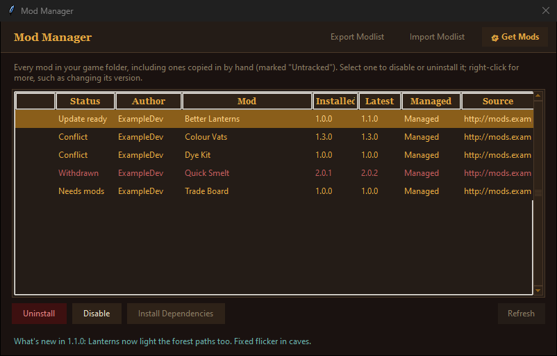
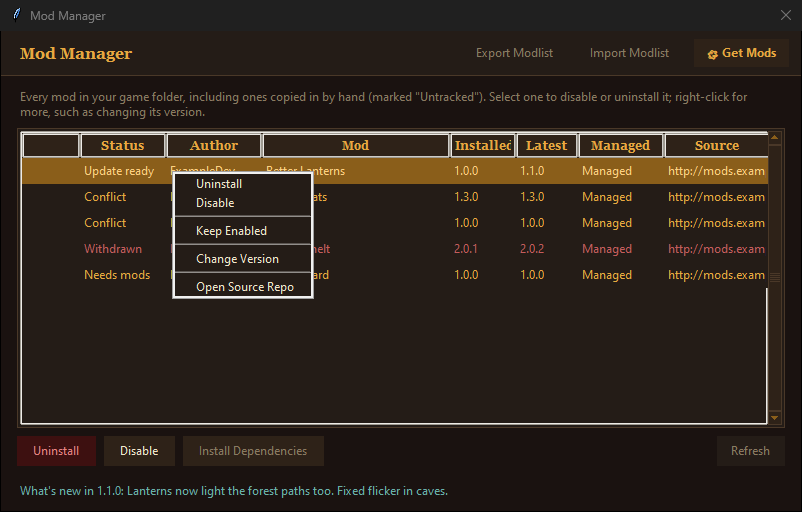
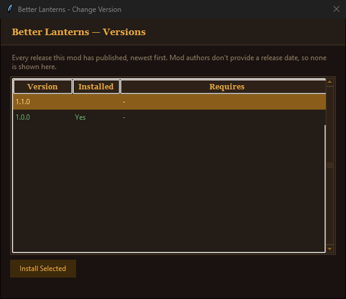

# Managing your mods

Click **Mod Manager**. It lists every mod in your game folder, including ones you copied in yourself.

Close the game before changing anything.

## What the status means

| Status | What it means | What to do |
| --- | --- | --- |
| **Up to date** | All good. | Nothing. |
| **Update ready** | A newer version is out. | Click **Update** on it in **Get Mods**, or right-click it and pick **Change Version**. |
| **Disabled** | Installed but turned off. | **Enable** if you want it. |
| **Needs mods** | It needs other mods you don't have. | **Install Dependencies**. |
| **Damaged** | Its files don't match what was installed. | Reinstall it from **Get Mods**. |
| **Missing** | Its files are gone. | Reinstall it from **Get Mods**. |
| **Replaced** | Its author moved it to a new mod. | **Switch to ...** installs the new one and removes the old. |
| **Withdrawn** | This version was pulled because it was broken or harmful. | Click **Update to ...**. Selecting it shows why it was withdrawn. |
| **Conflict** | It doesn't work with another mod you have on. | Turn one of them off. Selecting it says why. |
| **Untracked** | You copied it in yourself, so the launcher doesn't manage it. | You can turn it on or off, but not update it. |

Selecting a **Withdrawn** or **Conflict** mod tells you why at the bottom, and the button next to **Disable** offers the fix:

When any mod needs your attention, the **Mod Manager** button shows how many, like **Mod Manager (2 need attention)**.

## What's new

When an update is ready, pick the mod. If its author wrote what changed, it shows at the bottom of the window.

## The buttons

Pick a mod first.

| Button | What it does |
| --- | --- |
| **Disable** / **Enable** | Turns it off or on. Disabling keeps the files. |
| **Uninstall** | Removes it. |
| The fix button | Changes to what that mod needs: **Update to ...** for a withdrawn version, **Switch to ...** for a replaced mod, **Disable ...** for a clash, **Install Dependencies** for missing mods. |
| **Refresh** | Checks everything again. |

Right-click a mod for more:

- **Keep Enabled** keeps it on even when you join a server that doesn't run it. It gets a 📌.
- **Change Version** lets you pick an older or newer version.
- **Open Source Repo** opens its page on GitHub.

**Change Version** opens a list of every version. Pick one and click **Install Selected**.

## Mods on servers

When you join a server, the launcher turns on what that server needs and turns off what it doesn't. Turned-off mods are never deleted. See [Servers with mods](../joining/servers-with-mods.md).

## Something went wrong?

See [Troubleshooting](../troubleshooting.md#mods).
