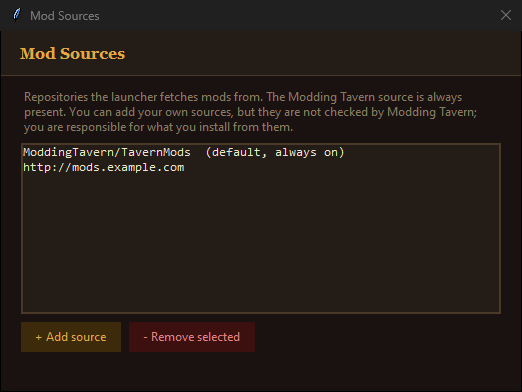
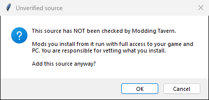

# Mod sources

A mod source is a list of mods the launcher can install from. You start with one: **TavernMods**, The Modding Tavern's list. It can't be removed.

Every mod on TavernMods is checked and scanned before it's listed. Other sources aren't checked by anyone but whoever runs them.

:::danger

Mods run on your PC with the same access as the game. A mod from a source you don't trust could do anything. Only add a source if you know and trust who runs it.

:::

## Adding one

1. Open **Mod Manager**, then **Get Mods**.
2. Click **Manage Sources**.
3. Click **+ Add source** and paste the source's address. It looks like `https://raw.githubusercontent.com/SomeOwner/SomeMods/main`.
4. The launcher warns you that it's an **Unverified source**. If you trust it, go ahead.

Its mods now show in **Get Mods**, with the source next to them.

## Removing one

In **Manage Sources**, pick it and click **- Remove selected**. Mods you installed from it stay installed, but won't update.

## Servers and sources

If a server runs a mod from a source you haven't added, the launcher can't install it, and says which source it's from. Add it if you trust it, then join again.
