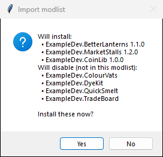

# Modlists

A modlist is a small file listing a set of mods and their versions. It's an easy way to share your setup with a friend, or to set up a server with the same mods.

## Sharing yours

1. Open **Mod Manager**.
2. Click **Export Modlist**.
3. Save the file and send it to whoever wants it.

Mods you copied in yourself (**Untracked**) are listed in it, but can't be installed from it. Your friend has to get those the same way you did.

## Loading one

1. Close the game.
2. Open **Mod Manager**.
3. Click **Import Modlist** and pick the file.
4. Check what it's going to install, then go ahead.

A modlist only installs from sources you've already added. If it names a source you don't have, add it yourself first, but only if you trust it. See [Mod sources](mod-sources.md).

## Making one on the web

The [Server Modlist](https://moddingtavern.github.io/TavernMods/#modlist) page on TavernMods lets you pick mods and download a modlist. It's made for servers, but works for your own game too.
