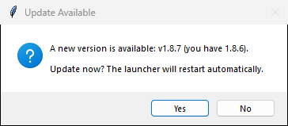

# Staying up to date

There are three things that get updates. The launcher tells you about all of them.

## The launcher

A couple of seconds after the launcher opens, it checks for a new version. If there is one, it asks **Update Available**. Click **Yes**. It downloads the update and restarts itself.

If the update goes wrong, the launcher tells you, and you can update by hand:

1. Download the newest zip from the [releases page](https://github.com/ModdingTavern/TavernLauncher/releases/latest), like the [first time](getting-started/install-the-launcher.md).
2. Close the launcher.
3. Extract the new zip over your old launcher folder, and say yes to replacing files.

Your settings, tokens and mods aren't in that folder, so nothing is lost.

## Setup

When the patch, MelonLoader or TavernLib have an update, the **Setup** button flashes. Open it and click **Update** on each row that has one.

## Mods

When a mod has an update, the **Mod Manager** button shows a count. Open it to see which, then click **Update** on them in **Get Mods**. See [Managing your mods](mods/managing-mods.md).

Mods a server needs are updated for you when you join it.

## Something went wrong?

See [Troubleshooting](troubleshooting.md#updating).
