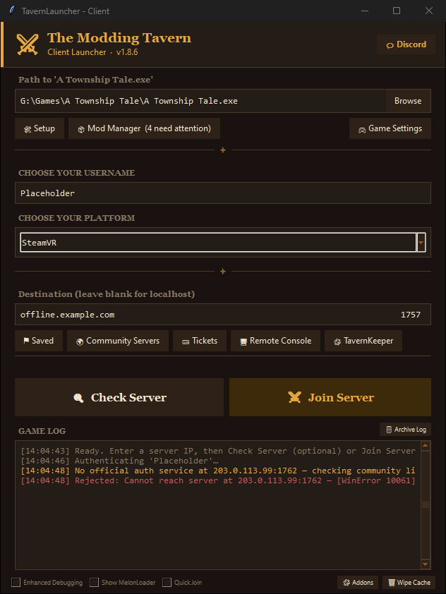

import Tabs from '@theme/Tabs';
import TabItem from '@theme/TabItem';

# Troubleshooting

Find your problem below. If it's not here, try [General troubleshooting](../help/general-troubleshooting.md), or [ask for help](../help/getting-help.md).

<Tabs groupId="client" queryString>
<TabItem value="pc" label="PC" default>

## The launcher won't open

- **"Windows protected your PC".** Click **More info**, then **Run anyway**.
- **Your antivirus deleted or blocked it.** Restore it from your antivirus's quarantine and allow it. The launcher is [open source](https://github.com/ModdingTavern/TavernLauncher). Only download it from there.
- **Nothing happens.** Make sure you extracted the zip first. Running it from inside the zip doesn't work.
- **It opens and closes straight away.** Look in `%APPDATA%\TheModdingTavern\addon_load_errors.log` for why, and send it when [getting help](../help/getting-help.md).

## Setup and Mod Manager are greyed out

The launcher doesn't know where your game is. Click **Browse** and pick **A Township Tale.exe**. See [Set up the game](getting-started/set-up-the-game.md).

## Setup won't finish

If a part keeps failing to download:

1. **Try again** with **Install** on that row. The internet sometimes just hiccups.
2. **Run the launcher as Administrator.** Right-click it, **Run as administrator**. This fixes a lot.
3. **Turn off your VPN** if you use one.
4. **Check your antivirus.** It might be blocking the download or the file. Allow the launcher in it.
5. **Controlled Folder Access.** If Windows Security has this on, it stops the launcher changing your game folder. Allow the launcher in **Windows Security**, **Virus & threat protection**, **Ransomware protection**.
6. **Use Install manually.** The row's **Install ... manually...** button walks you through downloading it in your browser and putting it in place. Click **Re-check** after.

It shouldn't take more than a minute or two. If one sits there much longer, something's blocking it. Use the manual install.

## Sent to the main menu or a black screen

You click **Join Server** and end up in the game's main menu, or stuck on a black screen. That means the setup didn't fully work, even if Setup said it did. Some PCs quietly block the files the launcher copies in.

Do it by hand. You'll use the files in the launcher's **Patch** folder.

1. Close the game.
2. **The patch:** copy `themoddingtavern.dll` from the **Patch** folder. Go to your game folder, then `A Township Tale_Data\Managed`. Paste it there, delete the old `Root.Township.dll`, and rename the one you pasted to `Root.Township.dll`.
3. **TavernLib:** copy `TavernLib.dll` from the **Patch** folder into your game folder's `Plugins` folder. Make the `Plugins` folder if it isn't there.
4. **MelonLoader:** copy `MelonLoader.x64.zip` from the **Patch** folder into your game folder (next to **A Township Tale.exe**), right-click it and **Extract All...** right there. You should now have a `MelonLoader` folder and a `version.dll` next to the game.
5. Open the launcher, check Setup shows them all, and join again.

The newest versions are also on GitHub: [the patch](https://github.com/ModdingTavern/TavernDefaults/releases/latest), [TavernLib](https://github.com/ModdingTavern/TavernLib/releases/latest), [MelonLoader](https://github.com/LavaGang/MelonLoader/releases/latest).

If it still happens, check you have the last version of the game, `main-1.7.2.1.42203`.

## Joining

- **"Cannot reach server".** The server is off, the address is wrong, or it can't be reached from your network. Check the address with whoever runs it. Try **Check Server** first.
- **"Name taken by someone else, or you lost the token to your account!"** Someone else has that name on this server, or it's yours and your token is missing. Pick another name, or ask the server's owner to reset your account.
- **"Wrong password."** It's case sensitive. You get a few tries before you have to wait.
- **"Too many accounts registered from your address."** The server only allows a few accounts per internet connection. Use one you already made, or ask the owner.
- **"You are not permitted."** You're banned from that server, or not on its whitelist.
- **"Bizarre mode detected."** You picked **Fly**, which needs a role from the server's owner. Pick your headset instead.
- **"The game is running".** The launcher started the game already. Close it first, or click **Yes** to try anyway.
- **The game starts but your headset doesn't.** Start SteamVR or the Meta Quest Link app **before** you click **Join Server**, and check you picked the right one under **CHOOSE YOUR PLATFORM**.
- **The forest is missing or broken.** The server's still making a new world, or its web port is blocked. Wait a few minutes and rejoin, or tell the host.

When a join fails, the reason is in red in the **GAME LOG**:

## Mods

- **"This server needs mods that aren't in any source you've added".** The server got a mod from a source you don't have. See [Mod sources](mods/mod-sources.md).
- **The server runs a withdrawn version.** Nobody can join until the host updates it. Let them know.
- **"Mod changes declined; not launching."** You clicked **Cancel** in the Mod Comparison window. Join again and click **Apply changes**.
- **"You are missing mods that are required for this server."** in the game. Try joining again from the game. See [If the game turns you away](joining/servers-with-mods.md#if-the-game-turns-you-away).
- **A mod says Damaged or Missing.** Reinstall it from **Get Mods**. If that fails, **Clear Mod Cache** first.
- **A download keeps failing.** **Clear Mod Cache** in **Get Mods**, and check your antivirus.

## Updating

- **"Update failed" or "Update didn't fully apply".** Update by hand. See [Staying up to date](staying-up-to-date.md#the-launcher). The details are in `%TEMP%\tavern_update_log.txt`.

## Lots of red text in the log

That's normal. The game logs a lot of errors even when it works fine. Lines about `alta.com` are the old servers that don't exist any more. Ignore them.

</TabItem>
<TabItem value="quest" label="Quest">

:::note[Coming soon]

Fixes for the standalone Quest version.

:::

</TabItem>
</Tabs>

## Still stuck?

[General troubleshooting](../help/general-troubleshooting.md) has fixes that work for lots of problems, and [Getting help](../help/getting-help.md) says what to send when you ask.
